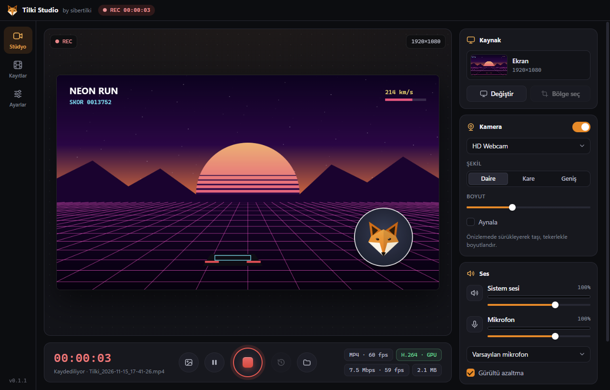
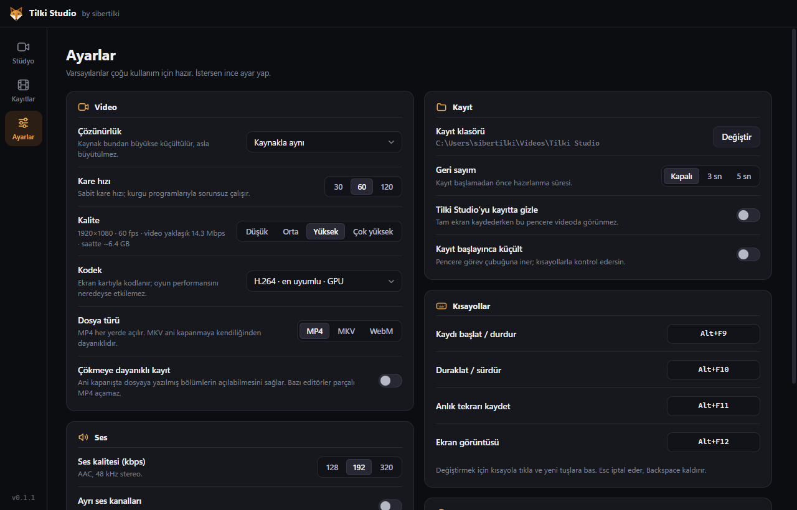
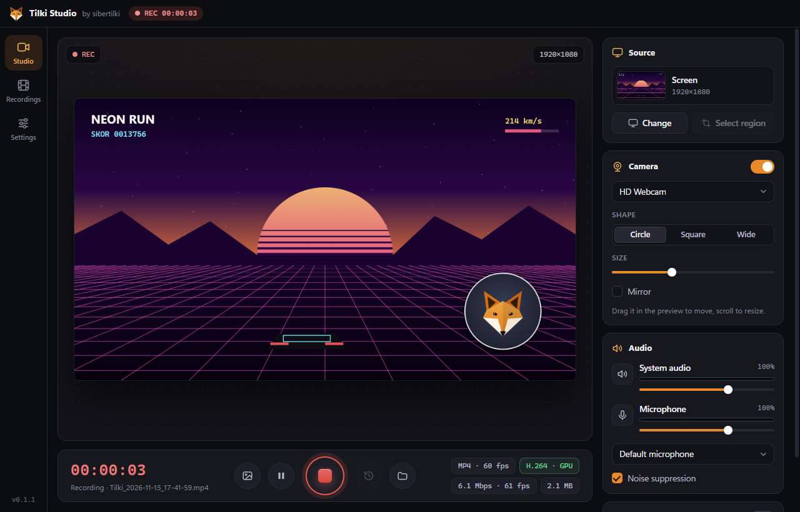
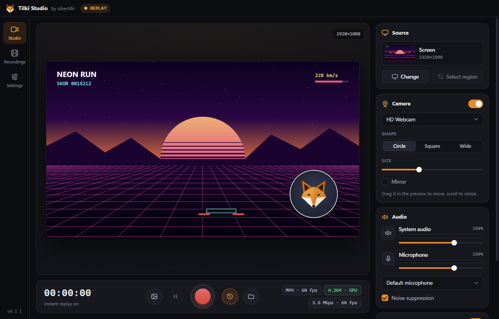
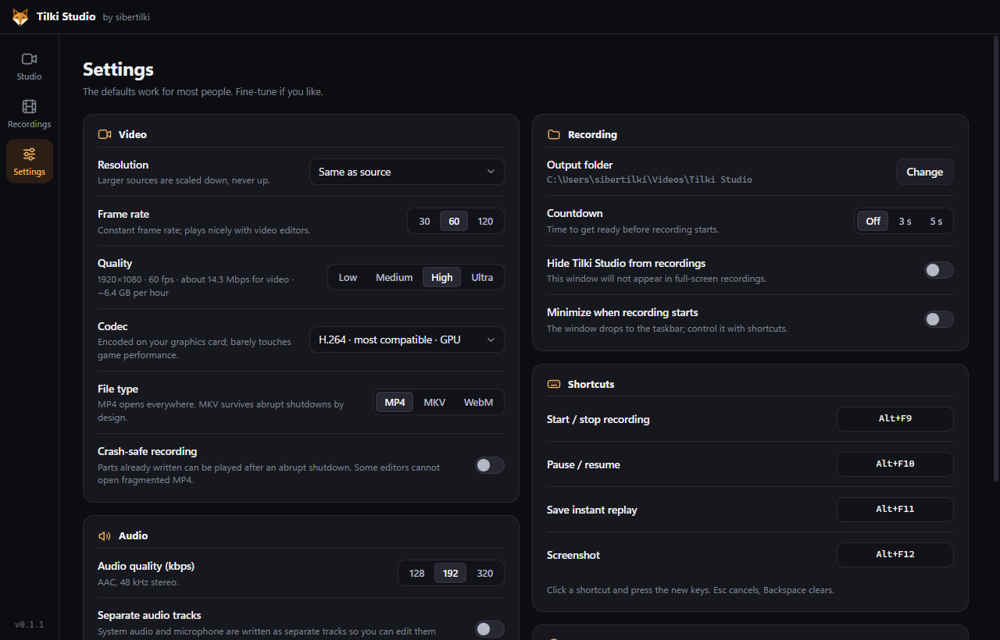

<p align="center">
  
</p>

<h1 align="center">Tilki Studio</h1>

<p align="center">
  <b>Aç. Kaydet. Bitti.</b><br>
  Hızlı, sade ve tamamen ücretsiz açık kaynak ekran kaydedici.<br>
  Reklam yok · filigran yok · hesap yok · süre sınırı yok
</p>

<p align="center">
  <a href="https://github.com/werhamer/tilki-studio/releases/latest"></a>
  <a href="https://github.com/werhamer/tilki-studio/releases"></a>
  
  <a href="LICENSE"></a>
</p>

<p align="center">
  <a href="https://github.com/werhamer/tilki-studio/releases/latest"><b>⬇ İndir (Windows)</b></a>
  &nbsp;·&nbsp; <a href="#özellikler">Özellikler</a>
  &nbsp;·&nbsp; <a href="#sık-sorulanlar">SSS</a>
  &nbsp;·&nbsp; <a href="#english">English</a>
</p>

<p align="center">
  
</p>

---

## Neden?

OBS çok güçlü, ama çoğu insan sadece **ekranını kaydetmek** istiyor. Sahne, kaynak,
profil, bit hızı tablosu derken ilk kayda kadar yarım saat geçiyor.

Tilki Studio tersinden başlar: açtığında ekranın zaten önizlemededir, kırmızı düğmeye
basarsın, kayıt başlar. İnce ayar isteyenler için ayarlar bir tık ötede.

## Özellikler

| | |
|---|---|
| 🎬 **Tek tuşla kayıt** | Tam ekran, tek pencere ya da fareyle çizdiğin bir bölge |
| ⚡ **Ekran kartıyla kodlama** | H.264 / HEVC / AV1, kartın hangisini destekliyorsa. Donanım yoksa kendiliğinden işlemciye geçer |
| 🎞️ **Sabit kare hızı** | 30 / 60 / 120 fps. Kurgu programlarında ses kayması olmaz |
| 🔊 **Sistem sesi + mikrofon** | Canlı seviye göstergeleri, ayrı ses düzeyleri, gürültü azaltma |
| 🎚️ **Ayrı ses kanalları** | Sistem sesi ve mikrofon dosyaya iki ayrı iz olarak yazılır, kurguda ayrı düzenlenir |
| 📷 **Kamera kutusu** | Daire, kare ya da geniş. Önizlemede sürükle, fare tekerleğiyle büyüt |
| ⏪ **Anlık tekrar** | Arka planda son 15–120 saniyeyi tutar; güzel an yaşandıktan *sonra* tek tuşla kaydet |
| ⏸️ **Duraklat / sürdür** | Tek dosya, kesintisiz |
| 🛟 **Ani kapanmaya dayanıklı** | MKV yapısı gereği dayanıklıdır; MP4 için "çökmeye dayanıklı kayıt" seçeneği var |
| ⌨️ **Genel kısayollar** | Oyun içindeyken de çalışır, istediğin gibi değiştir |
| 🗂️ **Kayıt kütüphanesi** | Önizleme, oynatma, klasörde göster, çöp kutusuna taşı |
| 🫥 **Kayıtta gizlen** | Tam ekran kaydederken Tilki Studio penceresi videoya girmez |
| 🌐 **Türkçe ve İngilizce** | Arayüz iki dilde |

Geri sayım, kayıt başlayınca küçülme, tek tıkla ekran görüntüsü de var.

<p align="center">
  
  
</p>
<p align="center">
  
</p>

## Performans

Kayıt motoru arayüzden bağımsız bir iş parçacığında çalışır. Pencere küçültülse ya da
bir oyunun arkasında kalsa bile kayıt tam hızda sürer.

Ölçümler, AMD Radeon RX 6600 ve 12 iş parçacıklı işlemcili bir bilgisayarda 1080p60
H.264 kayıt sırasında alındı:

| | Sonuç |
|---|---|
| İşlemci kullanımı, pencere açıkken | işlemcinin ~%6'sı |
| İşlemci kullanımı, pencere küçültülmüşken | işlemcinin ~%4,6'sı |
| Atlanan kare (51 sn test, ekranda hareket varken) | 0 |
| Ses-görüntü kayması (51 sn boyunca) | 25 ms'nin altında, zamanla artmıyor |
| Kayıt tuşuna basınca kaydın başlaması | ~15 ms (kodlayıcı arka planda hazır bekler) |

Sonuçlar ekran kartına ve sürücüye göre değişir.

## OBS ile dürüst karşılaştırma

| | Tilki Studio | OBS Studio |
|---|---|---|
| İlk kayda kadar geçen süre | Aç, bas | Sahne + kaynak kurulumu |
| Ekran / pencere / bölge kaydı | ✅ | ✅ |
| Donanım kodlama | ✅ | ✅ |
| Anlık tekrar | ✅ | ✅ |
| Kamera kutusu | ✅ | ✅ |
| Canlı yayın (Twitch, YouTube) | ❌ henüz yok | ✅ |
| Çoklu sahne, geçişler, filtreler | ❌ | ✅ |
| Eklenti ekosistemi | ❌ | ✅ |

Yayıncıysan ya da karmaşık sahneler kuruyorsan OBS hâlâ doğru araç. Sadece temiz bir
kayıt istiyorsan Tilki Studio daha kısa yol.

## Kurulum

[Son sürüm sayfasından](https://github.com/werhamer/tilki-studio/releases/latest) indir:

- **`TilkiStudio-Setup-x.y.z.exe`**: kurulum (önerilen)
- **`TilkiStudio-Portable-x.y.z.exe`**: kurulumsuz, tek dosya; USB bellekte taşınabilir

Windows 10 ya da 11 (64 bit) gerekir.

> **Windows "bilgisayarınız korundu" uyarısı verirse:** uygulama henüz dijital
> sertifikayla imzalanmadı (sertifikalar ücretli). **Ek bilgi → Yine de çalıştır**
> ile açabilirsin. Kaynak kodun tamamı bu depoda; istersen kendin derleyebilirsin.

## Varsayılan kısayollar

| İş | Kısayol |
|---|---|
| Kaydı başlat / durdur | `Alt+F9` |
| Duraklat / sürdür | `Alt+F10` |
| Anlık tekrarı kaydet | `Alt+F11` |
| Ekran görüntüsü | `Alt+F12` |

Ayarlar → Kısayollar'dan değiştirebilirsin.

## Sık sorulanlar

**Kayıtlar nereye kaydediliyor?**
Varsayılan olarak `Videolar\Tilki Studio` klasörüne. Ayarlardan değiştirebilirsin.

**Hangi dosya türünü seçmeliyim?**
Emin değilsen **MP4**: her yerde açılır. Uzun kayıtlarda elektrik kesintisinden
korkuyorsan **MKV**: bilgisayar aniden kapansa bile o ana kadarki kayıt kurtulur.

**Mikrofonum görünmüyor ya da ses gelmiyor.**
Windows Ayarlar → Gizlilik ve güvenlik → Mikrofon'dan masaüstü uygulamalarının mikrofona
erişimine izin verildiğini kontrol et, sonra Tilki Studio'yu yeniden başlat.

**Oyun kaydederken FPS düşer mi?**
Kodlamayı ekran kartının ayrı kodlama birimi yapar; oyun performansına etkisi çok küçüktür.
Daha da azaltmak için Ayarlar'dan "Kayıt başlayınca küçült"ü aç.

**Verilerimi bir yere gönderiyor mu?**
Hayır. Hesap istemez, veri toplamaz, kayıtlarını hiçbir sunucuya göndermez. Her şey
bilgisayarında kalır; kodu açık olduğu için bunu herkes kontrol edebilir.

## Kaynaktan derleme

Node.js 20 veya üstü gerekir.

```bash
git clone https://github.com/werhamer/tilki-studio.git
cd tilki-studio
npm install
npm start          # derle ve çalıştır
npm run dist       # release/ klasörüne kurulum + taşınabilir exe üretir
```

### Otomatik test

```bash
bash scripts/selftest.sh ./test-out
```

Gerçek bir kayıt alır (duraklatma dahil), anlık tekrar ve ekran görüntüsü kaydeder,
sonra dosyaları `ffprobe` ile doğrular. Test sırasında pencere iki kez beyaz parlar
ve kısık bir bip çıkarır; bu, ses-görüntü senkronunu ölçmek içindir.

README görselleri `python scripts/screenshots.py docs` ile, gerçek ekran yerine
yapay bir demo sahnesiyle üretilir.

## Nasıl çalışıyor?

```
ekran / pencere ──┐
kamera ───────────┼─► birleştirme (OffscreenCanvas) ─► VideoEncoder (GPU) ─┐
                  │                                                        ├─► MP4 / MKV / WebM
sistem sesi ──┐   │                                                        │
mikrofon ─────┴─► ses mikseri (Web Audio) ───────────► AudioEncoder ───────┤
                                                                           └─► anlık tekrar tamponu
```

Kamera ve ölçekleme yoksa yakalanan kare tuvale hiç uğramadan doğrudan kodlayıcıya gider.

| Dosya | Görev |
|---|---|
| `src/main/main.js` | Pencere, tepsi, genel kısayollar, kaynak listesi, dosya yazımı |
| `src/main/preload.js` | Arayüz ile ana süreç arasındaki dar köprü |
| `src/renderer/src/worker.js` | Kayıt motoru: birleştirme, kodlama, muxing, anlık tekrar |
| `src/renderer/src/engine.js` | Ekran / kamera / ses yakalama ve ses mikseri |
| `src/renderer/src/app.js` | Arayüz mantığı |
| `src/renderer/src/i18n.js` | Çeviriler (yeni dil eklemek için tek dosya) |

Kodlama Chromium'un WebCodecs API'siyle, dosya yazımı [Mediabunny](https://mediabunny.dev)
ile yapılır. Ayrı bir FFmpeg kurulumuna gerek yoktur.

## Yol haritası

- [ ] Canlı yayın (RTMP)
- [ ] Fare tıklamalarını vurgulama, yakınlaştırma efekti
- [ ] Kayıt sonrası kırpma (baş / son)
- [ ] macOS ve Linux desteği (şu an yalnızca Windows'ta test edildi)
- [ ] Otomatik güncelleme

## Katkı

Her katkı memnuniyetle karşılanır:

- **Hata mı buldun?** [Sorun bildir](https://github.com/werhamer/tilki-studio/issues/new/choose).
  Ekran kartını ve Windows sürümünü yazman çok yardımcı olur.
- **Yeni dil mi eklemek istiyorsun?** `src/renderer/src/i18n.js` dosyasına aynı anahtarlarla
  bir sözlük ekleyip pull request aç.
- **Fikrin mi var?** Sorun açıp anlat.

---

## English

<p align="center">
  
</p>

**Tilki Studio** ("tilki" is Turkish for *fox*) is a fast, simple, free and open-source
screen recorder for Windows. Open it, press the red button, done.

- **One-click recording**: full screen, a single window, or a region you draw
- **GPU encoding**: H.264 / HEVC / AV1, with automatic CPU fallback
- **Constant frame rate**: 30 / 60 / 120 fps, editor-friendly, no audio drift
- **System audio + microphone**: live meters, per-source volume, noise suppression,
  optionally written as **separate tracks**
- **Webcam overlay**: circle, square or wide; drag it in the preview, scroll to resize
- **Instant replay**: keeps the last 15–120 seconds so you can save a moment *after* it happens
- **Pause / resume**, **crash-resilient MKV / fragmented MP4**, **global hotkeys**,
  **hide from capture**, countdown, screenshots, built-in recordings library
- **No ads, no watermark, no account, no telemetry.** Your recordings stay on your computer.

**Download** the installer or the portable `.exe` from the
[latest release](https://github.com/werhamer/tilki-studio/releases/latest).
Windows 10/11 64-bit. The app is not code-signed yet, so SmartScreen may warn on first
launch: choose **More info → Run anyway**.

Default hotkeys: `Alt+F9` record, `Alt+F10` pause, `Alt+F11` save replay, `Alt+F12`
screenshot. The UI is available in Turkish and English; translations are welcome in
`src/renderer/src/i18n.js`.

<p align="center">
  
  
</p>

---

## Lisans / License

[MIT](LICENSE) © sibertilki

Üçüncü taraf bileşenler / third-party components: [Electron](https://www.electronjs.org/)
(MIT), [Mediabunny](https://github.com/Vanilagy/mediabunny) (MPL-2.0). Ayrıntılar:
[THIRD_PARTY_NOTICES.md](THIRD_PARTY_NOTICES.md).
