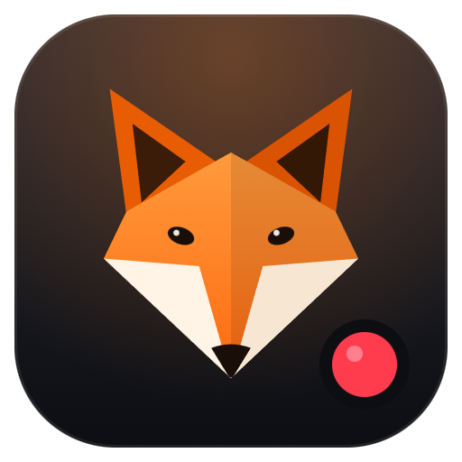
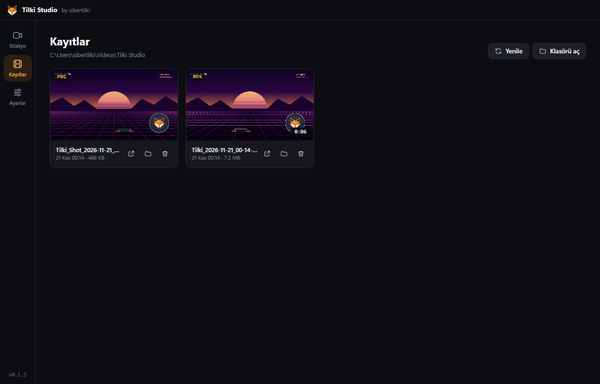
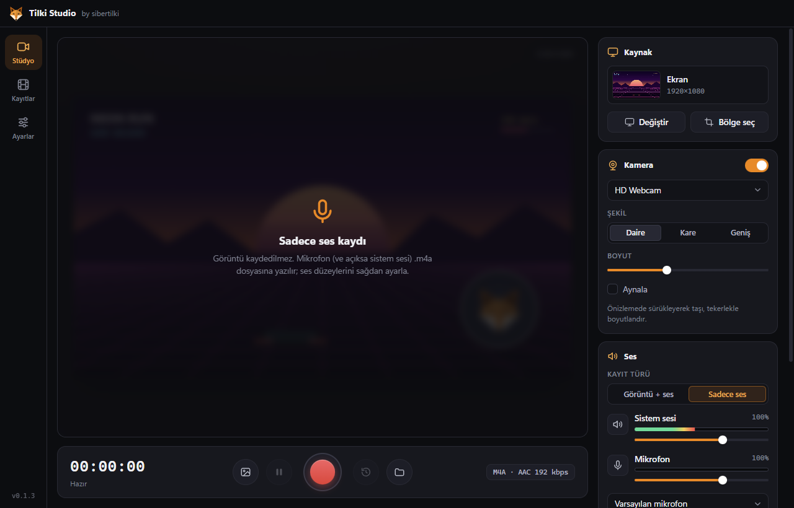
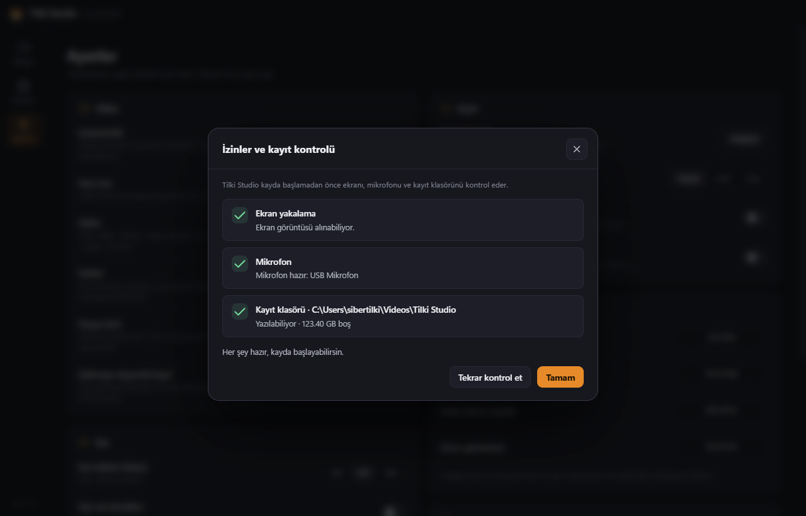
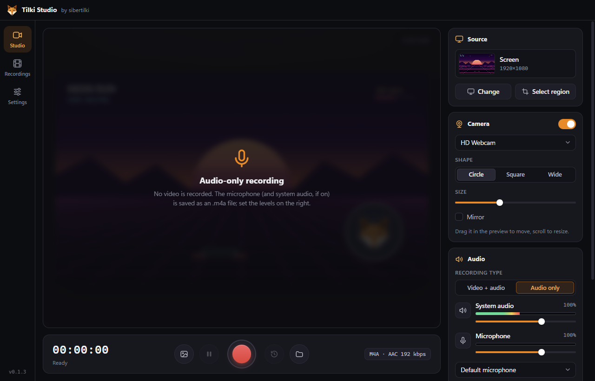
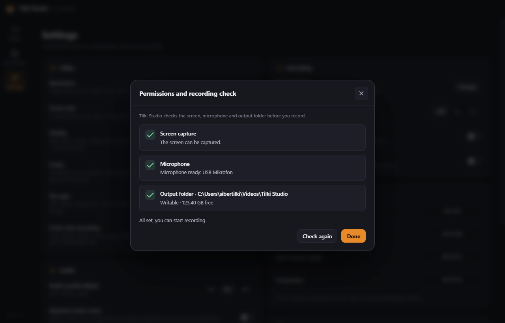

<p align="center">
  
</p>

<h1 align="center">Tilki Studio</h1>

<p align="center">
  <b>Aç. Kaydet. Bitti.</b><br>
  Hızlı, sade ve tamamen ücretsiz açık kaynak ekran kaydedici.<br>
  Reklam yok · filigran yok · hesap yok · süre sınırı yok
</p>

<p align="center">
  <a href="https://github.com/werhamer/tilki-studio/releases/latest"></a>
  <a href="https://github.com/werhamer/tilki-studio/releases"></a>
  
  <a href="LICENSE"></a>
</p>

<p align="center">
  <a href="https://github.com/werhamer/tilki-studio/releases/latest"><b>⬇ İndir (Windows)</b></a>
  &nbsp;·&nbsp; <a href="#özellikler">Özellikler</a>
  &nbsp;·&nbsp; <a href="#kurulum">Kurulum</a>
  &nbsp;·&nbsp; <a href="#sık-sorulanlar">SSS</a>
  &nbsp;·&nbsp; <a href="#english">English</a>
</p>

<p align="center">
  
</p>

<p align="center">
  <b><a href="https://www.youtube.com/@Aianatolyesi">Siber Tilki</a></b> tarafından yapıldı.
</p>

---

## Neden?

OBS çok güçlü, ama çoğu insan sadece **ekranını kaydetmek** istiyor. Sahne, kaynak,
profil, bit hızı tablosu derken ilk kayda kadar yarım saat geçiyor.

Tilki Studio tersinden başlar: açtığında ekranın zaten önizlemededir, kırmızı düğmeye
basarsın, kayıt başlar. İnce ayar isteyenler için ayarlar bir tık ötede.

## Özellikler

| | |
|---|---|
| 🎬 **Tek tuşla kayıt** | Tam ekran, tek pencere ya da fareyle çizdiğin bir bölge. Küçültülmüş pencereler de listelenir; seçince açılıp kaydedilir |
| ⚡ **Ekran kartıyla kodlama** | H.264 / HEVC / AV1, kartın hangisini destekliyorsa. Donanım yoksa kendiliğinden işlemciye geçer |
| 🎞️ **Sabit kare hızı** | 30 / 60 / 120 fps. Kurgu programlarında ses kayması olmaz |
| 🔊 **Sistem sesi + mikrofon** | Mikrofon seçimi, canlı seviye göstergeleri, ayrı ses düzeyleri. İstersen sistem sesini kapatıp yalnızca mikrofonu kaydet |
| 🤫 **Gürültü engelleme** | Kapalı / Normal / **Güçlü** (yapay zekâ tabanlı RNNoise: fan, klavye ve uğultuyu bastırır, konuşmayı korur). İstersen yankı engelleme |
| 🎙️ **Sadece ses kaydı** | Görüntüsüz kayıt: seslendirme ya da yorum için mikrofon (istersen sistem sesiyle) her yerde açılan `.m4a` dosyasına yazılır; duraklat / sürdür dahil |
| 🎚️ **Ayrı ses kanalları** | Sistem sesi ve mikrofon dosyaya iki ayrı iz olarak yazılır, kurguda ayrı düzenlenir |
| 📷 **Kamera kutusu** | Daire, kare ya da geniş. Önizlemede sürükle, fare tekerleğiyle büyüt |
| ⏪ **Anlık tekrar** | Arka planda son 15–120 saniyeyi tutar; güzel an yaşandıktan *sonra* tek tuşla kaydet |
| ⏸️ **Duraklat / sürdür** | Tek dosya, kesintisiz |
| 🛟 **Kaydını kaybetmezsin** | Disk ya da kodlayıcı hatasında o ana kadarki kayıt korunur; kodlayıcı hatasından sonra kayıt yeni dosyada kendiliğinden sürer |
| 🎙️ **Mikrofon koparsa haber verir** | USB mikrofon çıkarsa uyarı ve bildirim gelir, mikrofon kendiliğinden yeniden bağlanır |
| ✅ **İzin ve klasör kontrolü** | Windows mikrofonu kapattıysa ya da Windows Güvenliği kayıt klasörünü engelliyorsa ne yapacağını söyler, ilgili ayarı tek tıkla açar |
| 💾 **Disk alanı koruması** | Disk dolmak üzereyken uyarır, dolunca kaydı dosya bozulmadan kapatır |
| ⌨️ **Genel kısayollar** | Oyun içindeyken de çalışır, istediğin gibi değiştir |
| 🗂️ **Kayıt kütüphanesi** | Önizleme, oynatma, klasörde göster, çöp kutusuna taşı |
| 🫥 **Kayıtta gizlen** | Tam ekran kaydederken Tilki Studio penceresi videoya girmez |
| 🌐 **Türkçe ve İngilizce** | Arayüz iki dilde |

Geri sayım, kayıt başlayınca küçülme, tek tıkla ekran görüntüsü de var.

<p align="center">
  
  
</p>
<p align="center">
  
  
</p>
<p align="center">
  
</p>

## Kurulum

[Son sürüm sayfasından](https://github.com/werhamer/tilki-studio/releases/latest) birini indir:

| Dosya | Ne zaman? |
|---|---|
| **`TilkiStudio-Setup-x.y.z.exe`** | Kurulum (önerilen). Başlat menüsüne ve masaüstüne kısayol ekler |
| **`TilkiStudio-Portable-x.y.z.exe`** | Kurulumsuz, tek dosya; USB bellekte taşınabilir |
| **`TilkiStudio-x.y.z-win-x64.zip`** | Klasör hâlinde; istediğin yere çıkar, `Tilki Studio.exe`'yi çalıştır |

### "Windows bilgisayarınızı korudu" uyarısı

Tilki Studio henüz ücretli bir kod imzalama sertifikasıyla imzalanmadı. Bu yüzden Windows
ilk açılışta mavi bir uyarı gösterebilir:

1. **"Windows bilgisayarınızı korudu"** penceresinde **Ek bilgi**'ye tıkla.
2. Altta beliren **Yine de çalıştır** düğmesine bas.

Bu yalnızca ilk açılışta çıkar. İndirdiğin dosyanın değiştirilmediğinden emin olmak
istersen aşağıdaki SHA256 doğrulamasını yapabilirsin; kaynak kodun tamamı da bu depoda,
istersen kendin derleyebilirsin.

### İndirdiğin dosyayı doğrula (SHA256)

Her sürümde `SHA256SUMS.txt` dosyası bulunur. PowerShell'de:

```powershell
Get-FileHash .\TilkiStudio-Setup-0.1.3.exe -Algorithm SHA256
```

Çıkan değer `SHA256SUMS.txt` içindekiyle aynı olmalı.

### İlk açılış

İlk açılışta **İzinler ve kayıt kontrolü** penceresi gelir. Üç satır da yeşilse **Tamam**
de, kayda başla. Kırmızı satır varsa altındaki düğme ilgili Windows ayarını açar:

- **Mikrofon kırmızı:** Ayarlar → Gizlilik ve güvenlik → Mikrofon → "Masaüstü
  uygulamalarının mikrofona erişmesine izin ver"i aç.
- **Kayıt klasörü kırmızı:** Windows Güvenliği'nin *Denetimli klasör erişimi* özelliği
  açıksa Videolar klasörüne yazmayı engelleyebilir. Windows Güvenliği → Virüs ve tehdit
  koruması → Fidye yazılımı koruması → "Bir uygulamaya Denetimli klasör erişimi ile izin
  ver" bölümünden Tilki Studio'yu ekle ya da Tilki Studio'da başka bir klasör seç.

Bu kontrolü sonradan **Ayarlar → Genel → İzinler ve kayıt kontrolü** ile tekrar
çalıştırabilirsin.

## Sistem gereksinimleri

| | En az | Önerilen |
|---|---|---|
| İşletim sistemi | Windows 10 (64 bit) | Windows 11 |
| İşlemci | 4 çekirdek | 6 çekirdek ve üstü |
| Bellek | 4 GB | 8 GB ve üstü |
| Ekran kartı | Herhangi biri (donanım kodlama yoksa işlemci kullanılır) | NVIDIA GTX 10xx / AMD RX 5xx / Intel UHD 6xx ve sonrası |
| Disk | Kayıt için en az 1 GB boş yer | 1080p60 için saatte ~6–7 GB |

## Performans

Kayıt motoru arayüzden bağımsız bir iş parçacığında çalışır. Pencere küçültülse ya da
bir oyunun arkasında kalsa bile kayıt tam hızda sürer.

Ölçümler AMD Radeon RX 6600 ve 12 iş parçacıklı işlemcili bir bilgisayarda, 1080p60
H.264 kayıt sırasında alındı:

| | Sonuç |
|---|---|
| İşlemci kullanımı | işlemcinin ~%4–6'sı |
| Atlanan kare (62 sn test) | 0 |
| Ses-görüntü kayması | ~10 ms, zamanla artmıyor |
| Kayıt tuşuna basınca kaydın başlaması | ~15 ms (kodlayıcı arka planda hazır bekler) |

Sonuçlar ekran kartına ve sürücüye göre değişir.

## OBS ile dürüst karşılaştırma

| | Tilki Studio | OBS Studio |
|---|---|---|
| İlk kayda kadar geçen süre | Aç, bas | Sahne + kaynak kurulumu |
| Ekran / pencere / bölge kaydı | ✅ | ✅ |
| Donanım kodlama | ✅ | ✅ |
| Anlık tekrar | ✅ | ✅ |
| Kamera kutusu | ✅ | ✅ |
| Canlı yayın (Twitch, YouTube) | ❌ henüz yok | ✅ |
| Çoklu sahne, geçişler, filtreler | ❌ | ✅ |
| Eklenti ekosistemi | ❌ | ✅ |

Yayıncıysan ya da karmaşık sahneler kuruyorsan OBS hâlâ doğru araç. Sadece temiz bir
kayıt istiyorsan Tilki Studio daha kısa yol.

## Varsayılan kısayollar

| İş | Kısayol |
|---|---|
| Kaydı başlat / durdur | `Alt+F9` |
| Duraklat / sürdür | `Alt+F10` |
| Anlık tekrarı kaydet | `Alt+F11` |
| Ekran görüntüsü | `Alt+F12` |

Ayarlar → Kısayollar'dan değiştirebilirsin.

## Sık sorulanlar

**Kayıtlar nereye kaydediliyor?**
Varsayılan olarak `Videolar\Tilki Studio` klasörüne. Ayarlardan değiştirebilirsin.

**Açık bir pencere listede görünmüyor.**
Simge durumuna küçültülmüş pencereler "Küçültülmüş · seçince açılır" etiketiyle listenin
sonunda çıkar; seçtiğinde pencere açılır ve kaydedilir. Yönetici olarak çalışan bir
uygulamanın penceresi, Tilki Studio da yönetici olarak açılmadıkça listede görünmeyebilir.

**Sadece sesimi nasıl kaydederim?**
Stüdyo'da Ses kartındaki **Kayıt türü → Sadece ses**'i seç. Yalnızca mikrofonu istiyorsan
sistem sesi düğmesine basıp kapat. Kayıt `.m4a` olarak kaydedilir; "Ayrı ses kanalları"
açıksa mikrofon ve sistem sesi dosyada iki ayrı iz olur.

**Hangi dosya türünü seçmeliyim?**
Emin değilsen **MP4**: her yerde açılır. Uzun kayıtlarda elektrik kesintisinden
korkuyorsan **MKV**: bilgisayar aniden kapansa bile o ana kadarki kayıt kurtulur.

**Kayıt bir hatayla kesildi, dosya nerede?**
Tilki Studio dosyayı silmez; o ana kadarki kısım aynı klasörde durur ve uygulama bunu
bildirir. Nadiren bazı oynatıcılar böyle bir dosyada uyarı verebilir; `ffmpeg -i dosya.mkv
-c copy duzeltilmis.mkv` ile hızlıca düzeltilir.

**Bir sorun oldu, nasıl bildiririm?**
Hata günlükleri `%APPDATA%\Tilki Studio\logs` klasöründe tutulur (son 10 gün).
[Sorun bildirirken](https://github.com/werhamer/tilki-studio/issues/new/choose) o günün
günlüğünü eklemen çok yardımcı olur.

**Oyun kaydederken FPS düşer mi?**
Kodlamayı ekran kartının ayrı kodlama birimi yapar; oyun performansına etkisi çok küçüktür.
Daha da azaltmak için Ayarlar'dan "Kayıt başlayınca küçült"ü aç.

**Verilerimi bir yere gönderiyor mu?**
Hayır. Hesap istemez, veri toplamaz, kayıtlarını hiçbir sunucuya göndermez. Her şey
bilgisayarında kalır; kodu açık olduğu için bunu herkes kontrol edebilir.

## Kaynaktan derleme

Node.js 20 veya üstü gerekir.

```bash
git clone https://github.com/werhamer/tilki-studio.git
cd tilki-studio
npm install
npm start          # derle ve çalıştır
npm run dist       # release/ klasörüne kurulum + taşınabilir exe üretir
```

### Otomatik test

```bash
bash scripts/selftest.sh ./test-out
```

Gerçek bir kayıt alır (duraklatma dahil), anlık tekrar ve ekran görüntüsü kaydeder,
sonra dosyaları `ffprobe` ile doğrular. Test sırasında pencere iki kez beyaz parlar
ve kısık bir bip çıkarır; bu, ses-görüntü senkronunu ölçmek içindir.

README görselleri `python scripts/screenshots.py docs` ile, gerçek ekran yerine
yapay bir demo sahnesiyle üretilir.

## Nasıl çalışıyor?

```
ekran / pencere ──┐
kamera ───────────┼─► birleştirme (OffscreenCanvas) ─► VideoEncoder (GPU) ─┐
                  │                                                        ├─► MP4 / MKV / WebM
sistem sesi ──┐   │                                                        │
mikrofon ─────┴─► ses mikseri (Web Audio) ───────────► AudioEncoder ───────┤
                                                                           └─► anlık tekrar tamponu
```

Kamera ve ölçekleme yoksa yakalanan kare tuvale hiç uğramadan doğrudan kodlayıcıya gider.

| Dosya | Görev |
|---|---|
| `src/main/main.js` | Pencere, tepsi, genel kısayollar, kaynak listesi, dosya yazımı, izin kontrolü, günlük |
| `src/main/preload.js` | Arayüz ile ana süreç arasındaki dar köprü |
| `src/renderer/src/worker.js` | Kayıt motoru: birleştirme, kodlama, muxing, anlık tekrar |
| `src/renderer/src/engine.js` | Ekran / kamera / ses yakalama, ses mikseri, mikrofon yeniden bağlanma |
| `src/renderer/src/app.js` | Arayüz mantığı |
| `src/renderer/src/i18n.js` | Çeviriler (yeni dil eklemek için tek dosya) |

Kodlama Chromium'un WebCodecs API'siyle, dosya yazımı [Mediabunny](https://mediabunny.dev)
ile yapılır. Ayrı bir FFmpeg kurulumuna gerek yoktur.

## Yol haritası

- [ ] Canlı yayın (RTMP)
- [ ] Fare tıklamalarını vurgulama, yakınlaştırma efekti
- [ ] Kayıt sonrası kırpma (baş / son)
- [ ] macOS ve Linux desteği (şu an yalnızca Windows'ta test edildi)
- [ ] Otomatik güncelleme

## Katkı

Her katkı memnuniyetle karşılanır:

- **Hata mı buldun?** [Sorun bildir](https://github.com/werhamer/tilki-studio/issues/new/choose).
  Ekran kartını, Windows sürümünü ve varsa günlük dosyasını eklemen çok yardımcı olur.
- **Yeni dil mi eklemek istiyorsun?** `src/renderer/src/i18n.js` dosyasına aynı anahtarlarla
  bir sözlük ekleyip pull request aç.
- **Fikrin mi var?** Sorun açıp anlat.

Katkıların GPL-3.0 lisansıyla yayınlanır.

---

## English

<p align="center">
  
</p>

**Tilki Studio** ("tilki" is Turkish for *fox*) is a fast, simple, free and open-source
screen recorder for Windows, made by **[Siber Tilki](https://www.youtube.com/@Aianatolyesi)**.
Open it, press the red button, done.

### Features

- **One-click recording**: full screen, a single window, or a region you draw; minimized
  windows are listed too and are restored when you pick them
- **GPU encoding**: H.264 / HEVC / AV1, with automatic CPU fallback
- **Constant frame rate**: 30 / 60 / 120 fps, editor-friendly, no audio drift
- **System audio + microphone**: microphone picker, live meters, per-source volume, noise
  suppression, optionally written as **separate tracks**; mute system audio to record the mic only
- **Noise suppression**: Off / Normal / **Strong** (AI-based RNNoise that removes fans, keyboard
  and hum while keeping your voice), plus optional echo cancellation
- **Audio-only recording**: record voice-over or commentary without video to a universal `.m4a`
  file (with or without system audio), pause / resume included
- **Webcam overlay**: circle, square or wide; drag it in the preview, scroll to resize
- **Instant replay**: keeps the last 15–120 seconds so you can save a moment *after* it happens
- **Never lose a recording**: on a disk or encoder error the part recorded so far is kept,
  and after an encoder error recording continues in a new file automatically
- **Microphone watchdog**: if the mic disconnects you get a warning and it reconnects on its own
- **Permission & folder check**: tells you when Windows blocks the microphone or when
  Windows Security (Controlled folder access) blocks the output folder, with a button to
  the right setting
- **Disk space guard**: warns when the disk is almost full and closes the file safely when it is full
- **Pause / resume**, **crash-resilient MKV / fragmented MP4**, **global hotkeys**,
  **hide from capture**, countdown, screenshots, built-in recordings library
- **No ads, no watermark, no account, no telemetry.** Your recordings stay on your computer.

<p align="center">
  
  
</p>

### Download and install

Get one of these from the [latest release](https://github.com/werhamer/tilki-studio/releases/latest):

- **`TilkiStudio-Setup-x.y.z.exe`**: installer (recommended)
- **`TilkiStudio-Portable-x.y.z.exe`**: single portable file, no installation
- **`TilkiStudio-x.y.z-win-x64.zip`**: unzip anywhere and run `Tilki Studio.exe`

**"Windows protected your PC"**: the app is not code-signed yet, so SmartScreen may warn
on first launch. Click **More info**, then **Run anyway**. To verify your download, compare
`Get-FileHash <file> -Algorithm SHA256` with `SHA256SUMS.txt` in the release.

On first launch a **Permissions and recording check** window appears. If a row is red,
its button opens the matching Windows setting (microphone privacy, or Controlled folder
access in Windows Security). You can re-run it from **Settings → General**.

### System requirements

Windows 10 or 11 (64-bit), 4 GB RAM (8 GB recommended), any GPU (hardware encoding on
NVIDIA GTX 10xx / AMD RX 5xx / Intel UHD 6xx or newer, CPU fallback otherwise), at least
1 GB free disk space (1080p60 uses about 6–7 GB per hour).

Default hotkeys: `Alt+F9` record, `Alt+F10` pause, `Alt+F11` save replay, `Alt+F12`
screenshot. Logs are kept in `%APPDATA%\Tilki Studio\logs`. The UI is available in Turkish
and English; translations are welcome in `src/renderer/src/i18n.js`.

---

## Lisans / License

Tilki Studio, **GNU Genel Kamu Lisansı sürüm 3 ([GPL-3.0](LICENSE))** ile lisanslanmıştır.
Kodu kullanabilir, değiştirebilir ve dağıtabilirsin; türettiğin sürümler de GPL-3.0 ile açık
kaynak kalmalı ve telif bildirimini korumalıdır. Copyright © 2026 Siber Tilki.

Tilki Studio is licensed under the **GNU General Public License v3.0 ([GPL-3.0](LICENSE))**.
Derived works must remain open source under GPL-3.0 and keep the copyright notice.

> 0.1.2 ve öncesi MIT lisansıyla yayınlanmıştı; 0.1.3 ve sonrası GPL-3.0'dır.
> Versions up to 0.1.2 were released under MIT; 0.1.3 and later are GPL-3.0.

### Marka / Trademark

**"Tilki Studio" adı ve tilki logosu Siber Tilki'ye aittir** ve kod lisansına dahil değildir.
Fork'lar farklı bir ad ve logo kullanmalı, resmi sürüm gibi görünmemelidir. Ayrıntılar:
[TRADEMARKS.md](TRADEMARKS.md).

The **"Tilki Studio" name and fox logo belong to Siber Tilki** and are not covered by the
code license. Forks must use a different name and logo. See [TRADEMARKS.md](TRADEMARKS.md).

Üçüncü taraf bileşenler / third-party components: [Electron](https://www.electronjs.org/)
(MIT), [Mediabunny](https://github.com/Vanilagy/mediabunny) (MPL-2.0). Ayrıntılar:
[THIRD_PARTY_NOTICES.md](THIRD_PARTY_NOTICES.md).
